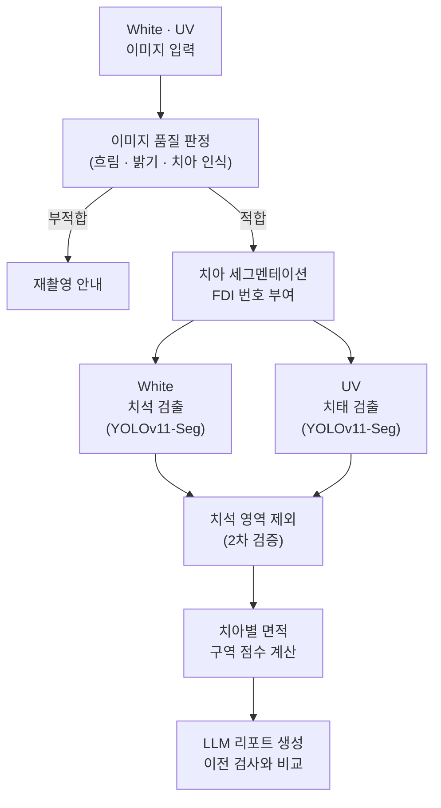

### 오래도록 건강한 내 치아를 위해, HabiTooth
: 가정용 AI 구강 모니터링 디바이스

    

<br clear="left"/>

## **🦷 1. 프로젝트 개요**


### 1-1. 프로젝트 소개
- 프로젝트 명 : [HabiTooth] 가정용 AI 구강 모니터링 디바이스
- 프로젝트 정의 : 집에서 백색광·UV 촬영으로 치석과 치태를 확인하고, AI 리포트로 관리 습관을 잡아주는 가정용 구강 모니터링 디바이스
- 서비스 흐름 : 구강 촬영 → AI 분석 → 3D 구강 지도·리포트 확인 → 관리 습관 기록

### 1-2. 개발 배경 및 필요성


- 치은염·치주질환 진료인원은 10년 사이 1,343만 명에서 1,997만 명으로 늘었지만, 치석은 쌓여도 통증이 없어 질환이 될 때까지 방치하기 쉽습니다.
<br>


- 권장 주기인 6개월마다 검진을 받는 사람은 16.1%뿐이고, 85.6%가 집에서 직접 구강 상태를 확인해 봤지만 60.2%는 자기 구강 상태를 잘 모른다고 답했습니다.
- 치태는 꾸준히 관리하면 치석이 되는 것을 예방할 수 있지만, 대부분은 치과에 가야만 내 구강 상태를 알 수 있습니다. 정기 검진 사이의 몇 달 동안은 어디를 잘 못 닦고 있는지 스스로 확인할 방법이 없어 같은 부위에 치태가 계속 쌓이게 됩니다.
- HabiTooth는 이 공백을 메우기 위해 집에서 직접 촬영하고, 관리가 필요한 부위를 치아 단위로 알려주는 보급형 구강 모니터링 서비스입니다.

### 1-3. 프로젝트 특장점
- 고가의 진단 장비 대신 ESP32-S3 기반 보급형 디바이스로, 가정에서도 치석과 치태를 나눠 확인할 수 있는 분석 환경을 구현
- 백색광과 405nm UV를 함께 쓰는 이중 광원 촬영으로 치석과 치태를 나눠서 확인
  - 405nm UV 형광은 치과용 형광 장비(QLF)에도 쓰이는 원리로, 0.3mm 황색 PVC 필터로 반사광을 줄여 붉은 형광을 또렷하게 촬영
- 백색광 영상은 치석을, UV 영상은 형광 반응이 나타난 치태를 각각 YOLOv11-Seg로 찾은 뒤, 치석 영역과 겹치는 부분을 제외하는 2차 검증으로 둘을 구분
- 팀이 제작한 전용 디바이스로 직접 수집하고 검수한 백색·UV LED 구강 데이터로 학습해, 실제 사용 환경과 같은 조건의 이미지로 모델을 구성
- 치아 세그멘테이션과 규칙 기반 FDI 번호 부여로 결과를 치아 단위로 정리
- 지난 검사와 비교해 변화를 짚어주는 LLM 리포트와 습관 기록을 연결해 꾸준한 관리로 이어지도록 구성

### 1-4. 주요 기능
<table>
  <tr><th width="140">기능</th><th>설명</th></tr>
<tr><td>구강 촬영</td><td>손에 쥐고 입안에 넣어 촬영하는 핸드헬드 디바이스로 윗니 안쪽 5개, 아랫니 안쪽 5개, 바깥쪽 3개 구역 중 원하는 구역을 골라 촬영합니다. 촬영 버튼을 한 번 누르면 백색광과 UV 이미지가 함께 촬영되어 전송됩니다.</td></tr>
  <tr><td>촬영 품질 확인</td><td>흐리거나 어두운 사진은 서버가 바로 판정해 다시 찍도록 안내합니다.</td></tr>
  <tr><td>AI 분석</td><td>치석과 치태가 쌓인 위치를 찾아 치아별 면적과 구역 점수로 계산합니다.</td></tr>
  <tr><td>3D 구강 시각화</td><td>관리가 필요한 치아를 3D 구강 템플릿 위에서 한눈에 확인합니다.</td></tr>
  <tr><td>AI 리포트</td><td>이전 검사와 비교해 새로 생기거나 계속 남아 있는 부위를 알려주고, 결과에 맞는 관리 방법을 안내합니다.</td></tr>
  <tr><td>기록 관리</td><td>검사 이력을 쌓아 구강 상태의 변화를 추적합니다.</td></tr>
  <tr><td>치아 프로필</td><td>결손치 등 내 치아 정보를 등록해 분석에 반영합니다.</td></tr>
</table>

### 1-5. 기대 효과 및 활용 분야

**기대 효과**
- **능동적 양치 습관 개선** : 3D 구강 모델과 쉬운 말로 풀어 쓴 리포트로 내 취약 부위를 직접 확인하며, 스스로 관리하는 습관을 만들 수 있습니다.
- **시공간 제약 해소** : 수천만 원대 전문 장비의 핵심 기능을 보급형 가정용 기기로 구현해, 언제 어디서나 저렴하게 구강 상태를 확인할 수 있습니다.
- **의료비 절감** : 치태·치석이 쌓이는 것을 일찍 알아차려 치주 질환으로 악화되기 전에 관리하도록 돕습니다.

**활용 분야**
- **치과 연계** : 쌓인 기록과 리포트를 사전 문진·원격 상담 자료로 활용해 병원 방문 전후의 관리 공백을 잇습니다.
- **아동 양치 교육** : 양치가 부족한 구역을 3D 구강 모델 위에 보여 주며 올바른 칫솔질을 익히는 교육 도구로 활용합니다.
- **향후 확장** : 구강 관리 데이터를 연계한 건강 증진형 보험, 치과 제휴와 맞춤 제품 추천 구독 서비스로 확장할 수 있습니다.

<sub>※ HabiTooth의 분석 결과는 구강 상태의 파악을 돕는 보조 진단 및 참고 목적으로만 제공되며, 전문적인 의료 자문·확진 및 치료를 대신하지 않습니다.</sub>

### 1-6. 기술 스택

| 구분 | 기술 |
|:---:|:---|
| **Hardware** |   |
| **Frontend** |      |
| **Backend** |    |
| **AI / LLM** |       |
| **Infra** |    |
<br>
<br>

## 🦷 2. 팀원 소개

<table>
  <tr>
    <td align="center" width="160"></td>
    <td align="center" width="160"></td>
    <td align="center" width="160"></td>
    <td align="center" width="160"></td>
    <td align="center" width="160"></td>
  </tr>
  <tr>
    <th>멘티 1 (팀장)</th>
    <th>멘티 2</th>
    <th>멘티 3</th>
    <th>멘티 4</th>
    <th>멘토</th>
  </tr>
  <tr>
    <td align="center">• 프로젝트 총괄<br>• 프론트엔드</td>
    <td align="center">• 하드웨어<br>• 백엔드</td>
    <td align="center">• 프론트엔드<br>• AI</td>
    <td align="center">• 백엔드<br>• AI</td>
    <td align="center">• 프로젝트 멘토<br>• 하드웨어 자문</td>
  </tr>
</table>
<br>
<br>


## 🦷 3. 시스템 구성도

### 3.1. 시스템 아키텍처

<br>

### 3.2. 서비스 흐름도

<br>

### 3-3. AI 분석 파이프라인


<br>

### 3.4. H/W 구성도
<table>
  <tr>
    <th align="center"><b>H/W 구성도</b></th>
    <th align="center"><b>실제 디바이스</b></th>
  </tr>
  <tr>
    <td align="center" width="80%"></td>
    <td align="center" width="20%"></td>
  </tr>
</table>
<br>

### 3.5. 메뉴 구성도 (IA)

<br>

### 3.6. 엔티티 관계도 (ERD)

<br>
<br>

## 🦷 4. 작품 소개영상

[](https://youtu.be/-6KwPk2JKww)

<br>
<br>

## 🦷 5. 핵심 소스코드

**5-1. UV 치태 검출 및 백색광 치석 영역 제외**
- 소스코드 설명 : UV 영상으로 학습한 YOLOv11-Seg 치태 모델이 예측한 영역을 픽셀 마스크로 만듭니다. 이어서 백색광에서 찾은 치석 영역을 FDI 번호로 같은 치아끼리 맞춘 뒤 UV 영상 좌표로 옮겨, 치태에서 제외할 치석 마스크를 만듭니다. UV에서도 형광을 띨 수 있는 치석이 치태로 잘못 잡히지 않도록 하는 2차 검증입니다.

```python
# UV 치태 YOLOv11-Seg 모델 예측 폴리곤을 픽셀 마스크로 변환
def _run_plaque_yolo_mask(image, shape_hw):
    h, w = shape_hw
    mask = np.zeros((h, w), dtype=bool)
    dets = _yolo_seg_detect(models["PLAQUE_YOLO"], image, PLAQUE_YOLO_CONF, PLAQUE_YOLO_IMGSZ)
    for d in dets:
        pts = np.array([[p["x"], p["y"]] for p in d["polygon"]], dtype=np.int32)
        m = np.zeros((h, w), dtype=np.uint8)
        cv2.fillPoly(m, [pts], 1)
        mask |= m.astype(bool)
    return mask

# 백색광 치석 영역을 같은 FDI 번호의 UV 치아 좌표로 옮겨 제외 마스크 생성
for ua in uv_tooth_areas:
    sg = src_by_fdi.get(ua.get("toothNumber"))            # 백색광의 같은 치아
    ug = _safe_polygon(_points_to_coords(ua.get("polygon", [])))
    for cg in calc_geoms:                                   # 백색광 치석 폴리곤
        if sg is None or ug is None or not sg.intersects(cg):
            continue
        for poly in _iter_polygons(sg.intersection(cg)):
            mapped = _safe_polygon(_map_polygon_bbox(
                list(poly.exterior.coords), sg.bounds, ug.bounds))
            if mapped is not None:
                _fill(mapped.intersection(ug))
```

<details>
<summary>전체 코드 보기</summary>

```python
def _run_plaque_yolo_mask(image, shape_hw):
    """UV 치태 YOLO-seg 모델(plaque_v2.pt) 예측 폴리곤을 픽셀 마스크로 변환해 반환."""
    h, w = shape_hw
    mask = np.zeros((h, w), dtype=bool)
    model = models["PLAQUE_YOLO"]
    dets = _yolo_seg_detect(model, image, PLAQUE_YOLO_CONF, PLAQUE_YOLO_IMGSZ, label_map=None)
    for d in dets:
        pts = np.array([[p["x"], p["y"]] for p in d["polygon"]], dtype=np.int32)
        m = np.zeros((h, w), dtype=np.uint8)
        cv2.fillPoly(m, [pts], 1)
        mask |= m.astype(bool)
    return mask

def _yolo_seg_detect(model, image, conf, imgsz, label_map=None, source=None):
    """YOLO-seg 추론 → detectedIssues 형식 리스트. label_map 이 None 이면 모두 PLAQUE 로 둔다."""
    kwargs = {"source": image, "conf": conf, "verbose": False}
    if imgsz:
        kwargs["imgsz"] = imgsz
    results = model.predict(**kwargs)[0]
    out = []
    if results.masks is None:
        return out
    polygons = results.masks.xy
    for idx, box in enumerate(results.boxes):
        c = float(box.conf[0])
        class_id = int(box.cls[0])
        if label_map is None:
            issue_type = "PLAQUE"
        else:
            issue_type = label_map.get(class_id, "UNKNOWN")
            if issue_type is None:
                continue
        cx, cy, w, h = box.xywh[0].tolist()
        pts = [{"x": int(p[0]), "y": int(p[1])} for p in polygons[idx]]
        if len(pts) < 3:
            continue
        out.append({
            "toothNumber": None,
            "issueType": issue_type,
            "confidence": round(c, 2),
            "bbox": [round(cx, 1), round(cy, 1), round(w, 1), round(h, 1)],
            "areaRatio": None,
            "polygon": pts,
        })
    return out

def _build_calculus_exclusion_mask(task_id, calculus_task_id, uv_tooth_areas, image_size):
    """백색광 치석 영역을 UV 영상 좌표로 옮긴 마스크를 만든다. 반환: (mask 또는 None, 진단 dict)."""
    info = {"applied": False, "sourceTaskId": None, "matchedTeeth": [],
            "unmatchedTeeth": [], "reason": None}
    if not PLAQUE_CALCULUS_EXCLUDE_ENABLED:
        info["reason"] = "disabled"
        return None, info

    src_id = calculus_task_id or task_id
    src = task_store.get(src_id)
    if src is None:
        info["reason"] = f"calculus task 없음({src_id})"
        return None, info
    if not src.get("calculus_step_done"):
        info["reason"] = "calculus 미실행"
        return None, info
    info["sourceTaskId"] = src_id

    issues = [i for i in src["result"].get("detectedIssues", [])
              if i.get("issueType") == "CALCULUS"]
    w, h = image_size
    mask = np.zeros((h, w), dtype=np.uint8)

    def _fill(geom):
        for poly in _iter_polygons(geom):
            pts = np.array(poly.exterior.coords, dtype=np.float64).round().astype(np.int32)
            if len(pts) >= 3:
                cv2.fillPoly(mask, [pts], 1)

    same_image = (src_id == task_id)
    if same_image:
        for issue in issues:
            _fill(_build_calculus_geometry(issue))
        info["matchedTeeth"] = ["same-image"]
    else:
        # 백색광 영상과 UV 영상의 치아를 FDI 번호로 매칭하고,
        # 치아 bbox 기준으로 치석 폴리곤을 UV 좌표계로 사상한다.
        src_by_fdi = {}
        for a in src["result"].get("toothArea", []):
            fdi = a.get("toothNumber")
            g = _safe_polygon(_points_to_coords(a.get("polygon", [])))
            if fdi is not None and g is not None:
                src_by_fdi[fdi] = g
        calc_geoms = [g for g in (_build_calculus_geometry(i) for i in issues) if g is not None]

        for ua in uv_tooth_areas:
            fdi = ua.get("toothNumber")
            ug = _safe_polygon(_points_to_coords(ua.get("polygon", [])))
            if fdi is None or ug is None:
                continue
            sg = src_by_fdi.get(fdi)
            if sg is None:
                info["unmatchedTeeth"].append(fdi)
                continue
            info["matchedTeeth"].append(fdi)
            for cg in calc_geoms:
                if not sg.intersects(cg):
                    continue
                piece = sg.intersection(cg)
                for poly in _iter_polygons(piece):
                    mapped = _safe_polygon(_map_polygon_bbox(
                        list(poly.exterior.coords), sg.bounds, ug.bounds))
                    if mapped is not None:
                        _fill(mapped.intersection(ug))

    if PLAQUE_CALCULUS_DILATE_PX > 0 and mask.any():
        k = 2 * int(PLAQUE_CALCULUS_DILATE_PX) + 1
        mask = cv2.dilate(mask, cv2.getStructuringElement(cv2.MORPH_ELLIPSE, (k, k)))

    info["applied"] = True
    info["calculusPixels"] = int(mask.sum())
    return mask.astype(bool), info
```
</details>

**5-2. 치아 세그멘테이션 정렬 및 FDI 번호 부여**
- 소스코드 설명 : 검출된 치아의 중심점을 주성분(PCA) 축에 투영해 치열 방향으로 정렬하고, 촬영 구역별 치아 번호 순서대로 FDI 번호를 붙입니다. 이웃한 치아 사이 간격이 평소보다 크게 벌어지면 결손치로 보고 번호를 건너뛰며, 치아 프로필에 등록한 결손치도 함께 반영합니다.

```python
# 중심 좌표를 PCA 주축에 투영해 치열 방향으로 정렬
order, proj, axis_vec = _pca_order([g["centroid"] for g in group], axis_ref=axis_ref)
ordered = [group[i] for i in order]

# 검출 개수가 구역 시퀀스와 같으면 1:1 매핑
if detected_count == core_count:
    for item, fdi in zip(ordered, core_filtered):
        item["fdi"] = fdi
    return

# 인접 중심 간격이 중앙값의 N배 이상이면 그 사이를 결손치로 보고 번호를 건너뜀
median_gap = float(np.median(np.abs(np.diff(proj))))
for i, item in enumerate(ordered):
    if i > 0:
        ratio = abs(proj[i] - proj[i - 1]) / median_gap
        if ratio >= SEQ_GAP_MISSING_FACTOR:
            seq_idx += round(ratio) - 1
    item["fdi"] = effective[seq_idx]
    seq_idx += 1
```

<details>
<summary>전체 코드 보기</summary>

```python
def _pca_order(centroids, axis_ref=None):
    """중심점을 주성분 축에 투영해 정렬. 반환: (정렬 인덱스, 투영값, 축 벡터)."""
    pts = np.array(centroids, dtype=np.float64)
    if len(pts) < 2:
        return np.arange(len(pts)), np.zeros(len(pts)), np.array([1.0, 0.0])
    mean = pts.mean(axis=0)
    centered = pts - mean
    cov = np.cov(centered.T)
    eigvals, eigvecs = np.linalg.eigh(cov)
    principal = eigvecs[:, int(np.argmax(eigvals))]
    if axis_ref is not None:
        if principal[0] * axis_ref[0] + principal[1] * axis_ref[1] < 0:
            principal = -principal
    elif abs(principal[0]) > abs(principal[1]):
        if principal[0] < 0:
            principal = -principal
    else:
        if principal[1] < 0:
            principal = -principal
    proj = centered @ principal
    order = np.argsort(proj)
    return order, proj[order], principal


def _assign_sequence(group, sequence, reverse, debug_label, end_extension=None,
                     start_extension=None, frame_size=None, missing_fdi=None,
                     image=None, axis_ref=None, zone_key=None):
    """정렬된 치아에 구역 시퀀스 순서대로 FDI 를 배정 (여유분·결손치·간격 반영)."""
    if not group:
        return
    missing_fdi = missing_fdi or set()
    end_ext = list(end_extension or [])
    start_ext = list(start_extension or [])

    # 1) 오탐 제거: 치열 축 이탈, 상대 품질, 치아 아님 확률
    group, off_arch = _remove_off_arch_outliers(group, frame_size=frame_size)
    if not group:
        return
    group, low_quality = _remove_relative_quality_outliers(group, zone_key or debug_label)
    if not group:
        return
    not_tooth = [g for g in group
                 if (g.get("type_probs") or {}).get("other", 0.0) >= TOOTH_TYPE_OTHER_THRESH]
    if not_tooth:
        group = [g for g in group if g not in not_tooth]
    if not group:
        return

    # 2) 중심 좌표를 PCA 주축에 투영해 치열 방향으로 정렬
    order, proj, axis_vec = _pca_order([g["centroid"] for g in group], axis_ref=axis_ref)
    if reverse:
        order = order[::-1]
        proj = proj[::-1]
        axis_vec = -axis_vec
    ordered = [group[i] for i in order]

    # 3) 검출 개수와 구역 핵심 시퀀스 개수 비교 → 잉여/부족 판단
    prefix = []
    skip_head = 0
    core_filtered = [fdi for fdi in sequence if fdi not in missing_fdi]
    core_count = len(core_filtered)
    detected_count = len(ordered)
    surplus = max(0, detected_count - core_count)
    deficit = max(0, core_count - detected_count)
    start_usable = [f for f in start_ext if f not in missing_fdi]
    end_usable = [f for f in end_ext if f not in missing_fdi]
    key = zone_key or debug_label
    max_pull = ZONE_START_EXTRA_MAX_PULL.get(key, SEQ_START_EXTRA_DEFAULT_MAX_PULL)

    # 양 끝 치아가 프레임 경계에 닿았는지로 어느 쪽이 잘렸는지 추정
    first_touch = bool(ordered) and _touches_border_toward(ordered[0].get("geom"), frame_size, -axis_vec)
    last_touch = bool(ordered) and _touches_border_toward(ordered[-1].get("geom"), frame_size, axis_vec)

    if surplus > 0:
        if first_touch and not last_touch:
            side = "start"
        elif last_touch and not first_touch:
            side = "end"
        else:
            side = ZONE_SURPLUS_PREFER.get(key, "end")
        if side == "start":
            pull = min(len(start_usable), surplus, max_pull)
        else:
            pull = min(len(start_usable), max(0, surplus - len(end_usable)), max_pull)
        prefix = list(reversed(start_usable[:pull]))
    elif deficit > 0:
        if first_touch and not last_touch:
            skip_head = deficit  # 시작 쪽이 잘린 것으로 보고 앞 번호를 건너뜀

    effective = prefix + list(sequence) + end_usable
    if not effective:
        for item in group:
            item["fdi"] = None
        return

    # 4) 개수가 정확히 일치하면 간격 추측 없이 1:1 매핑
    if detected_count == core_count:
        for item, fdi in zip(ordered, core_filtered):
            item["fdi"] = fdi
        return

    # 5) 인접 중심 간격이 중앙값의 N배 이상이면 그 사이를 결손치로 보고 번호를 건너뜀
    gaps = np.diff(proj) if len(proj) > 1 else np.array([])
    median_gap = float(np.median(np.abs(gaps))) if len(gaps) else 0.0

    seq_idx = skip_head

    def _advance_past_known_missing():
        """프로필에 등록된 결손치 자리를 건너뛴다."""
        nonlocal seq_idx
        while seq_idx < len(effective) and effective[seq_idx] in missing_fdi:
            seq_idx += 1

    _advance_past_known_missing()
    for i, item in enumerate(ordered):
        if i > 0 and median_gap > 1e-6:
            gap = abs(proj[i] - proj[i - 1])
            ratio = gap / median_gap
            if ratio >= SEQ_GAP_MISSING_FACTOR:
                seq_idx += round(ratio) - 1
                _advance_past_known_missing()
        if seq_idx >= len(effective):
            item["fdi"] = None
            continue
        item["fdi"] = effective[seq_idx]
        seq_idx += 1
        _advance_past_known_missing()

    # 6) 치아 종류 분류기 확률이 있으면 송곳니/어금니 경계 기준으로 번호 보정
    if any(it.get("type_probs") for it in ordered):
        _apply_tooth_type_shift(ordered, zone_key or debug_label, missing_fdi, debug_label,
                                proj=proj, sequence=sequence)


"""촬영 구역(zone)별 FDI 시퀀스·화이트리스트 정의."""

ZONE_FDI_WHITELIST = {
    "UPPER_RIGHT_MOLAR":    {18, 17, 16},
    "UPPER_RIGHT_PREMOLAR": {15, 14, 13},
    "UPPER_FRONT":          {12, 11, 21, 22},
    "UPPER_LEFT_PREMOLAR":  {23, 24, 25},
    "UPPER_LEFT_MOLAR":     {26, 27, 28},
    "LOWER_RIGHT_MOLAR":    {48, 47, 46},
    "LOWER_RIGHT_PREMOLAR": {45, 44, 43},
    "LOWER_FRONT":          {42, 41, 31, 32},
    "LOWER_LEFT_PREMOLAR":  {33, 34, 35},
    "LOWER_LEFT_MOLAR":     {36, 37, 38},
    "OUTER_RIGHT":  {12, 13, 14, 15, 16, 42, 43, 44, 45, 46},
    "OUTER_CENTER": {13, 12, 11, 21, 22, 23, 43, 42, 41, 31, 32, 33},
    "OUTER_LEFT":   {22, 23, 24, 25, 26, 32, 33, 34, 35, 36},
}
```
</details>

**5-3. 디바이스 펌웨어 : 백색광·UV 연속 촬영**
- 소스코드 설명 : XIAO ESP32-S3 Sense 기반 디바이스 펌웨어입니다. 촬영 버튼을 한 번 누르면 백색광과 UV 이미지를 차례로 고해상도(UXGA)로 촬영합니다. 자동 노출·게인을 끄고 조명별 고정값을 써서 형광 색이 촬영마다 달라지지 않게 했고, 조명을 바꾼 직후의 프레임은 버리고 안정된 프레임만 저장합니다.

```cpp
// 노출 수동 고정: 조명별로 같은 밝기·색으로 촬영
void applyProfile(sensor_t* s, bool isUV) {
  s->set_exposure_ctrl(s, 0);                         // 자동 노출 끔
  s->set_gain_ctrl(s, 0);                             // 자동 게인 끔
  s->set_aec_value(s, isUV ? g_uvAec : g_whiteAec);   // 조명별 고정 노출
  s->set_agc_gain(s, isUV ? g_uvAgc : g_whiteAgc);
}

// 조명 전환 후 이전 설정의 프레임을 버리고 안정된 프레임만 캡처
camera_fb_t* captureWithLight(LedMode mode) {
  setLed(mode);                                       // LED 점등 + 프로파일 적용
  delay(120);
  for (int i = 0; i < 2; i++) esp_camera_fb_return(esp_camera_fb_get());
  return esp_camera_fb_get();
}

// 버튼 한 번 → 백색광 + UV 연속 촬영 (UXGA)
void capturePair() {
  xSemaphoreTake(camMutex, pdMS_TO_TICKS(4000));
  setFs(FRAMESIZE_UXGA);
  for (int i = 0; i < 2; i++) {
    bool isUV = (i == 1);
    camera_fb_t* fb = captureWithLight(isUV ? LED_UV : LED_WHITE);
    storePending(i, fb, makeFilename(isUV));          // PSRAM 버퍼에 저장
    esp_camera_fb_return(fb);
  }
  setFs(g_streamFs);
  setLed(LED_OFF);
  xSemaphoreGive(camMutex);
  pendSeq++;                                          // 웹이 감지해 이미지를 가져감
}
```

**5-4. 백색광·UV 이미지 수신**
- 소스코드 설명 : 디바이스 버튼으로 찍은 백색광·UV 이미지를 모두 받은 뒤 촬영 처리 함수로 넘깁니다. 받은 이미지는 임시로 보관해서, 전송이 실패해 다시 시도할 때 이미 받은 이미지는 다시 요청하지 않습니다.
- [useHardwareShutter.ts](https://github.com/HabiTooth/26_HF001/blob/main/frontend/src/hooks/useHardwareShutter.ts)

```typescript
transferring.white ??= await pick(0);
transferring.uv ??= await pick(1);
if (!alive) return;
await onCaptureRef.current({ white: transferring.white, uv: transferring.uv });
lastSeq.current = seq;
transferring = null;
transferFailures = 0;
```

**5-5. 치석·치태 결과를 합친 구역 점수**
- 소스코드 설명 : 백색광으로 구한 치석 점수와 UV로 구한 치태 점수에 각각 가중치를 곱해 구역 점수를 계산합니다. 한쪽 결과만 있으면 그 결과만 반영하고, 둘 다 없으면 점수를 매기지 않습니다. 가중치는 치석 1.0, 치태 0.6입니다.
- [ScoreCalculator.java](https://github.com/HabiTooth/26_HF001/blob/main/backend/src/main/java/com/habitooth/backend/domain/ai/service/ScoreCalculator.java)

```java
public static Double combineZoneScore(Double calculusZoneScore, Double plaqueZoneScore) {
    if (calculusZoneScore == null && plaqueZoneScore == null) {
        return null;
    }

    double damage = 0.0;
    if (calculusZoneScore != null) {
        damage += CALCULUS_SEVERITY_WEIGHT * (100.0 - calculusZoneScore);
    }
    if (plaqueZoneScore != null) {
        damage += PLAQUE_SEVERITY_WEIGHT * (100.0 - plaqueZoneScore);
    }

    return round1(Math.max(0.0, 100.0 - damage));
}
```

**5-6. 그 밖의 주요 코드**

<table>
  <tr><th width="200">소스코드</th><th>역할</th></tr>
  <tr><td><a href="https://github.com/HabiTooth/26_HF001/blob/main/backend/src/main/java/com/habitooth/backend/domain/ai/service/AiAnalysisService.java">AiAnalysisService.java</a></td><td>AI 추론 서버에 분석을 요청하고 결과를 저장</td></tr>
  <tr><td><a href="https://github.com/HabiTooth/26_HF001/blob/main/backend/src/main/java/com/habitooth/backend/domain/llm/service/LlmReportService.java">LlmReportService.java</a></td><td>현재·이전 분석 결과를 묶어 LLM 리포트를 생성하고 저장</td></tr>
  <tr><td><a href="https://github.com/HabiTooth/26_HF001/blob/main/frontend/src/constants/scanZones.ts">scanZones.ts</a></td><td>13개 촬영 구역과 치아 번호 매핑</td></tr>
  <tr><td><a href="https://github.com/HabiTooth/26_HF001/blob/main/frontend/src/views/ReportPage.tsx">ReportPage.tsx</a></td><td>분석 리포트 화면</td></tr>
</table>

처음에는 오늘 결과를, 다음부터는 변화를 먼저 보도록 설계했습니다.

<table>
  <tr><th width="50%">첫 촬영</th><th width="50%">재촬영</th></tr>
  <tr><td>1. 오늘 결과<br>2. 점수 해석<br>3. 지금 할 일</td><td>1. 이전 기록과 비교<br>2. 같은 치아·같은 면 변화<br>3. 관리 결과 확인</td></tr>
</table>

